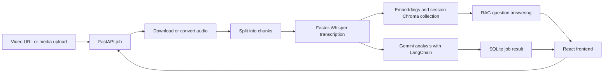

# Framewise — AI Video Assistant

Framewise turns a video or audio recording into a concise, searchable brief. Submit a supported media URL or upload an audio/video file to generate a transcript, summary, action items, key decisions, and open questions. You can then ask questions grounded in that transcript.

This is a learning project exploring speech-to-text, LangChain, retrieval-augmented generation (RAG), FastAPI, and React.

## Features

- Process a supported video URL with `yt-dlp` or upload an audio/video file (up to 200 MB).
- Convert uploaded media to 16 kHz mono WAV, download URL audio as WAV, and split audio into 10-minute chunks.
- Transcribe locally with Faster-Whisper (`small` model by default, CPU with int8 compute).
- Use Gemini through LangChain to create a title, summary, action items, decisions, and open questions.
- Create a session-specific Chroma collection for transcript retrieval and RAG Q&A.
- Track job status and save job results in SQLite.
- Use the React interface to submit media, view results, and chat about a completed video.

## How it works



## Tech stack

| Area | Tools |
| --- | --- |
| Frontend | React, Vite |
| API | FastAPI, Uvicorn |
| Speech-to-text | Faster-Whisper |
| LLM workflows | LangChain, Google Gemini |
| Vector search | Chroma, Sentence Transformers (`all-MiniLM-L6-v2`) |
| Job storage | SQLite |
| Media handling | yt-dlp, FFmpeg, pydub |

## Requirements

- Python 3.10 or newer
- Node.js and npm
- FFmpeg available on your system PATH
- Deno 2.3 or newer for yt-dlp's YouTube JavaScript challenge support
- A Google Gemini API key

The first run downloads the Faster-Whisper model and the embedding model. Allow extra time and disk space for these downloads.

## Setup

### 1. Clone the repository

```powershell
git clone <repository-url>
cd <repository-folder>
```

### 2. Set up the Python environment

```powershell
py -m venv .venv
.\.venv\Scripts\Activate.ps1
python -m pip install --upgrade pip
pip install -r requirements.txt
```

Install FFmpeg and Deno separately, then open a new terminal so both are available on PATH. Deno can be installed on Windows with:

```powershell
winget install DenoLand.Deno
```

### 3. Configure the backend

Create a root-level `.env` file:

```env
GEMINI_API_KEY=replace-with-your-gemini-api-key
WHISPER_MODEL=small
```

Keep this file private. Do not commit API keys or put them in frontend environment variables.

### 4. Start the API

From the repository root, with the virtual environment active:

```powershell
uvicorn api.main:app --reload
```

The API runs at `http://127.0.0.1:8000`. Interactive API documentation is at `http://127.0.0.1:8000/docs`.

### 5. Start the frontend

In a second terminal:

```powershell
cd frontend
npm ci
```

Create `frontend/.env`:

```env
VITE_API_BASE_URL=http://127.0.0.1:8000
```

Then run:

```powershell
npm run dev
```

Open the local URL printed by Vite, usually `http://localhost:5173`.

## API endpoints

| Method | Endpoint | Purpose |
| --- | --- | --- |
| `GET` | `/health` | Check that the API is running |
| `POST` | `/videos` | Start processing a supported media URL; returns a job ID |
| `POST` | `/uploads` | Upload an audio/video file; returns an upload ID |
| `POST` | `/uploads/{upload_id}/process` | Start processing an uploaded file; returns a job ID |
| `GET` | `/jobs/{job_id}` | Read job status and, when complete, generated results |
| `POST` | `/jobs/{job_id}/chat` | Ask a question about a completed job |
| `GET` | `/jobs/{job_id}/chat` | Read saved chat messages |

The frontend polls the job endpoint while processing is queued or running.

## Data and generated files

The application writes runtime data locally:

- `app_data/video_assistant.db` — SQLite job records and chat messages
- `vector_db/` — Chroma collections, one per video session
- `uploads/` — uploaded files while they are being processed
- `downloads/` — downloaded media, converted audio, and transcription chunks

These paths are excluded from Git. Processing artifacts in `downloads/` are not automatically cleaned up yet, so they can use disk space over time.

## Current limitations

- This is a local learning/demo application, not a production-ready public service.
- The API has no authentication or rate limiting. Do not expose it publicly as-is; submitted jobs use your compute and Gemini quota.
- URL input is not restricted to an allow-list of websites. Add host validation and other URL-fetch protections before accepting requests from untrusted users.
- URL downloads depend on yt-dlp and the source website's availability and rate limits. Uploading a media file is an alternative when a URL cannot be downloaded.
- Processing uses FastAPI in-process background tasks. A server restart can interrupt a running job; use a durable job queue for reliable deployment.
- SQLite and Chroma use local files. A hosted environment must provide persistent storage or use managed storage services.
- Chat messages are saved by the API, but the frontend does not yet restore them when the page reloads.
- There is no automated test suite yet. `test.py` is a manual script that downloads and transcribes a hard-coded URL, so it requires network access and calls the real processing stack.

## Learning goals

This project was built to practice:

- Building a multi-step media and AI pipeline
- Using Faster-Whisper for local transcription
- Creating LangChain workflows and a RAG retriever
- Separating transcript collections by session
- Connecting a React frontend to a FastAPI backend
- Handling background jobs, API errors, logs, and local persistence

## License

No license has been added yet. Until one is chosen, reuse and redistribution permissions are not explicitly granted.
